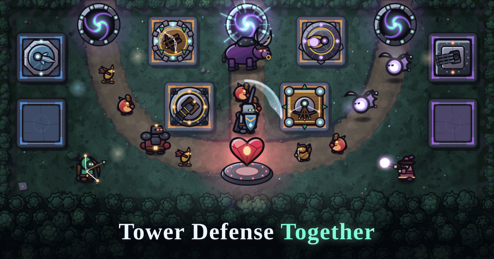

# Press kit and first impression

What a stranger sees before they play: the link preview, the screenshots and clip in a post, and the first load on a phone. The channels and their tags are in [`ANALYTICS.md`](ANALYTICS.md); the art rules for the card and the splash are in [`ART.md`](ART.md) §14.

## 1. The pitch and the link preview

**The pitch** is README.md's line 3, word for word. Use it in posts and store fields; don't write a new one per channel.

> A browser co-op tower defense for 1–3 players (one per lane): build towers, control a hero and hold the Heart against waves of creeps.

**The link preview.** `apps/client/index.html` carries the tags every site reads (`test/linkPreview.test.ts` checks them):

| Tag | Value |
|---|---|
| `og:title`, `twitter:title` | Tower Defense Together |
| `og:description`, `twitter:description`, `<meta name="description">` | the pitch above |
| `og:image`, `twitter:image` | `https://tgt-td-cld.vercel.app/og-card.png` (1200 × 630, PNG, with `og:image:alt` / `twitter:image:alt`) |
| `og:url`, `<link rel="canonical">` | `https://tgt-td-cld.vercel.app/` |
| `og:type`, `og:site_name`, `twitter:card` | `website`, Tower Defense Together, `summary_large_image` |



The card is drawn from the game's own art (`?ogcard` on the dev server). To change it, edit `apps/client/src/ogCard.ts`, run `npm run og -w @tdt/client`, look at the PNG and commit it (ART.md §14).

## 2. Four screenshots

Phone-size, portrait, the way most players will see the game. Take them on a real phone or in Chrome DevTools' device mode:

1. `npm run dev` (solo) or the production URL. Open DevTools → **Toggle device toolbar** (Ctrl/Cmd + Shift + M) → pick **Pixel 7** (412 × 915) or **iPhone 12 Pro** (390 × 844, the same screen as an iPhone 13). Keep the device pixel ratio the preset gives (2.625 / 3), so a capture is sharp.
2. Capture with DevTools' **⋮ → Capture screenshot** (the device frame off). Not "full size": the game is one screen.
3. Display **Normal** (⚙ → Display). Bright is for washed-out phone screens and looks flat in a post.

The four:

| # | Where | What to show |
|---|---|---|
| 1 | Solo, **Quick**, Normal, wave 3–4 (build phase between waves) | The whole Spire map: towers on your pads, your hero by a lane, gold and the wave timer in the top bar. Tap a tower so its ring shows. |
| 2 | Same match, **wave 5 or 10** (a boss wave) | The boss on a lane with its banner, towers firing, the hero fighting. Wave 5 also brings the first Wisps. |
| 3 | A room of 2: a Ranger and an Arcanist at level 6 (Practice Meteor Rain was removed on 17 Oct 2026) | Both cast R within 2 s as a wave arrives: the lanes fill with the **Meteor Rain** strikes and the combo ribbon. Capture as the strikes land. |
| 4 | The **end screen** of a won Quick match | The beating Heart emblem, "Victory!" and the match stats. |

**The current set** (17 Oct 2026, the map plate of V-03, `docs/ART.md` §16) is in `docs/screenshots/map/press/`: 1–3 taken from the e2e build in headless Chromium at Pixel 7 size (412 × 915, DPR 2.625) by a script, so they show the build's own frames; take them again on a real phone for a store page. The end screen (4) is its card over the dimmed match; it was not retaken (it needs a won Quick match).

For a store page or a press post, add one from `/?showcase`: the **Heroes** cards (Ranger, Warden, Arcanist) or the **Towers** cards (tier 3 and a branch), in Normal, with the device toolbar at the same phone. The showcase is a dev page: crop to the cards, not the page header.

Skip the first-match lesson (it starts on a new player's first solo match) with **Skip**, or use a browser profile that has already played.

## 3. A 15-second clip

One take from a real match, about 15 s, portrait, sound on (Reddit and X autoplay muted, so the picture has to carry it):

- **0–4 s:** build phase: place a tower and upgrade one (the radial menu on a phone).
- **4–10 s:** a wave hits: towers firing, the hero fighting on a lane (a boss wave if you can).
- **10–15 s:** the ultimate: Arrow Storm or Meteor raining on all three lanes, or the Meteor Rain combo in a room of a Ranger and an Arcanist, with the kill count.

**Recording:**

- **iPhone:** Control Centre → **Screen Recording** (add it in Settings → Control Centre if it's missing). Turn on a **Focus** (Do Not Disturb) first so no banner lands in the clip. The game's sound is recorded; the silent switch mutes it (the game plays as ambient audio).
- **Android:** Quick Settings → **Screen record** → "Record audio: Device audio", and turn on **Do Not Disturb**.
- **Desktop:** DevTools device mode at Pixel 7 or iPhone 12 Pro, then the OS recorder on that area: macOS **Cmd + Shift + 5** (record a selected portion), Windows **Win + Shift + R** (Snipping Tool) or **Win + Alt + R** (Xbox Game Bar, whole window), or OBS. Close other tabs and silence notifications (macOS Focus, Windows Do not disturb).

**Trimming:** on the phone, Photos → Edit → drag the ends; or on a computer with ffmpeg (H.264 + AAC plays everywhere):

```bash
ffmpeg -ss 00:01:05 -i recording.mov -t 15 -vf "scale=-2:1280" -c:v libx264 -crf 23 -preset slow \
  -pix_fmt yuv420p -c:a aac -b:a 128k -movflags +faststart clip.mp4
```

`-ss` is where the clip starts, `-t 15` its length, `scale=-2:1280` a 1280 px tall portrait (most sites re-encode bigger files anyway).

## 4. Tagged links and checking the card

Every post, and every message to testers, uses its channel's link (ANALYTICS.md), so the dashboard can tell the channels apart, and **Where new players stop → By link** gives each its own first-visit funnel:

| Where | Link |
|---|---|
| Friends retest (P2-05) | `https://tgt-td-cld.vercel.app/?src=friends` |
| Cold test (H-09) | `https://tgt-td-cld.vercel.app/?src=cold` |
| r/PlayMyGame | `https://tgt-td-cld.vercel.app/?src=reddit-playmygame` |
| r/WebGames | `https://tgt-td-cld.vercel.app/?src=reddit-webgames` |
| r/TowerDefense | `https://tgt-td-cld.vercel.app/?src=reddit-towerdefense` |
| CrazyGames | `https://tgt-td-cld.vercel.app/?src=crazygames` |
| Players' share cards (written by the game, never posted by hand) | `https://tgt-td-cld.vercel.app/?src=share` |

**Players' share cards** (p6d-share, `docs/GAME_DESIGN.md` "Daily run"): after a posted Daily run (**Share my run**) and on an Endless end screen (**Share**), a player's tap makes a 1200 × 630 picture of their result in the game's own look (the hero's stage poster, the gold trim, the wordmark) and shares it with the link `<the page's origin>/?src=share`, so every visit from one counts under **Shared cards** in the dashboard. It is not the link card above: that one is `og-card.png`, what crawlers show under any link. Examples: `docs/screenshots/daily-share/`.

**The order (Han, 8 Oct 2026; `TASKS.md` → Now → The order from here):** the friends retest on the friends link, the cold test on the cold link (three to five people who have never seen the game, no help), one fix round, then the first post, **r/PlayMyGame only**. r/WebGames and then r/TowerDefense follow one at a time, each only after the previous post's numbers are read. The gate (D-06) reads the first session per link: started a match, finished it, started a second one, and the rating. CrazyGames comes with Gate 2, after D-06. While a post is live, no merge changes the sim or the protocol (each one restarts the game server).

A tagged link shows the same card as the bare URL: the tags are in `index.html` for every query string, the canonical URL is a tag only, and the page never rewrites its address, so `?src=` reaches the analytics (`e2e/platform.spec.ts` and `test/linkPreview.test.ts` check both).

**After each deploy that changes the card or the tags**, check the preview before posting:

- **Facebook Sharing Debugger** (https://developers.facebook.com/tools/debug/): paste the tagged link, **Scrape Again**; it lists every `og:` tag it read and shows the card. Facebook, Messenger and WhatsApp use what it caches.
- **LinkedIn Post Inspector** (https://www.linkedin.com/post-inspector/): the same for LinkedIn.
- **opengraph.xyz** (https://www.opengraph.xyz/): previews Facebook, X, LinkedIn and Discord side by side.
- **Discord and Reddit:** paste the link into a private channel or a draft post; X has no validator any more, so use a draft post there too.

The image URL is the production one, so a Vercel **preview** deploy shows the production card (or none, before the first deploy that has `og-card.png`). Crawlers cache the image by URL for days to weeks: a new card needs a **new file name** (`og-card-2.png`, both tags) to reach links that were already shared, then a re-scrape in the debuggers above.

## 5. First load on a phone

How long a stranger on a slow phone waits before they can play. Measured with `npm run first-load -w @tdt/client` (`apps/client/scripts/firstLoad.ts`), never estimated.

**Method.** The script builds the production client with a placeholder game server (`VITE_SERVER_URL=wss://example.invalid`, so the online home card renders exactly as in production; the home card opens no WebSocket until Create or Join) into `apps/client/dist-firstload`, serves it with `vite preview`, and loads `/` in headless Chromium (Playwright) as a **Pixel 7** (412 × 839 viewport, DPR 2.625, touch) with:

- **Lighthouse's mobile throttling ("Slow 4G")** through CDP `Network.emulateNetworkConditions`: **562.5 ms latency, 1474.56 kbps down, 675 kbps up** (Lighthouse's 150 ms RTT / 1.6 Mbps / 750 kbps, as DevTools applies them), plus `Emulation.setCPUThrottlingRate` **4×**;
- a **cold cache** (a fresh browser context per run and `Network.setCacheDisabled`) and **service workers blocked**;
- analytics posts blocked, so measurement visits never reach the rollout dashboard.

It records the **first contentful paint** (on this branch, the boot splash), main.ts's **`tdt:ready`** mark (the first screen is up), and **usable**: `<html data-ready>` is set, the home card is shown, and **Play solo** is enabled, on screen and the element a tap at its centre would hit. If Play solo never comes on screen, the run says so and where the button is. Flags: `--runs N` (default 5), `--no-build`, `--url <page>` (measure a deployed build instead), `--latency`, `--down`, `--up`, `--cpu`; `--sheets` (also wait for every 3D sheet), `--match` (below), `--hero <kind>` (the home card's hero for `--match`, the Ranger by default), `--music` (docs/ART.md §13). Service workers stay blocked: CDP's throttling is the page's, so a worker would install at full speed and fill the HTTP cache the page then reads (a first try at measuring the precache that way found the art in 3.3 s, which no phone on Slow 4G would see).

**`--match` (V-07d): Play solo → the first wave's art.** Each run taps **Play solo** the moment the lobby is usable (the age question answered beforehand: a measurement is not a player), on Full with the picked hero, and records how long from that tap until every picture the match's first wave shows is in (`tdt:first-wave-art`: the map plate, the structures' sheet, the first wave's creep sheets, the Grunts' on Full, and the hero's sheet), how long the match held its start for them (`tdt:art-hold-end`, at most 6 s, and why it ended: `in` or `timeout`) and their bytes. Tapping at once is the worst case: a player who reads the home card first gives the art that long to come in.

**Results, 3 Oct 2026** (Playwright 1.56.1, Chromium headless, Node 22.14, a 4-core Intel Xeon VM; CPU 4× slower than that machine):

| Build | Runs | First contentful paint | `tdt:ready` | Usable (Play solo tappable) | Transferred |
|---|---|---|---|---|---|
| This branch (`cursor/link-preview-first-load-1287`, local `vite preview`) | 7 | median **1.56 s** (1.54–1.59 s), the splash | median 3.93 s (3.91–3.99 s) | median **4.50 s** (4.49–4.62 s) | 302 KB |
| Production before it (https://tgt-td-cld.vercel.app/, `--url`) | 5 | median 1.64 s (1.61–1.67 s), the bare HUD markup | median 4.05 s (4.04–4.11 s) | **never**: Play solo's top at 830 px of 839, below the fold | 315 KB |

**Results, 14 Oct 2026** (V-05a, the 3D Ranger's stage: the poster shows at once, the video loads after the first screen; same machine class and script, local `vite preview`, 7 runs each):

| Build | Runs | First contentful paint | `tdt:ready` | Usable (Play solo tappable) | Transferred |
|---|---|---|---|---|---|
| `main` before V-05a (V-01 home card and V-02's solo stage) | 7 | median **2.13 s** | median 5.24 s | median **6.77 s** | 326 KB |
| V-05a (`ccr-879951c4-0qeuxg`) | 7 | median **2.12 s** (1.71–2.16 s) | median 5.21 s (5.04–5.60 s) | median **6.68 s** (6.43–7.15 s) | 387 KB (+61 KB: almost all of it the stage poster, about 60 KB) |

The video itself is never part of the first load (it starts loading 600 ms and an idle moment after `tdt:ready`). The rows above from 3 Oct are not comparable with these (the home card has changed since).

**Results, 15 Oct 2026** (V-05a round 2, PR #106: the Ranger and his clearing as one picture, a sharper 2400 × 900 loop; back to back with #105's head on the same 4-core VM, local `vite preview`, 7 runs each):

| Build | Runs | First contentful paint | `tdt:ready` | Usable (Play solo tappable) | Transferred |
|---|---|---|---|---|---|
| #105 (`ccr-879951c4-0qeuxg`) | 7 | median **2.14 s** (1.73–2.22 s) | median 5.27 s (5.19–5.63 s) | median **7.12 s** (6.81–7.54 s) | 388 KB |
| #106 (`ccr-f19ccefe-s6r998`) | 7 | median **2.14 s** (2.13–2.18 s) | median 5.40 s (5.15–5.51 s) | median **6.96 s** (6.66–7.25 s) | 388 KB |

The same bytes on the first load (the new poster is the same size); the larger video (1.14 MB, was 0.68) still loads only after the first screen. The VM ran about 0.35 s slower to a usable lobby than on 14 Oct for both builds, so compare the rows within a day, not across.

**Results, 17 Oct 2026** (V-03, PR #114: the map plate; back to back on the same 4-core VM, local `vite preview`, 5 runs each; `main` is #112's head, with V-05b round 2's stage):

| Build | Runs | First contentful paint | `tdt:ready` | Usable (Play solo tappable) | Transferred |
|---|---|---|---|---|---|
| `main` (#112) | 5 | median **2.15 s** (2.11–2.17 s) | median 5.32 s (5.21–5.56 s) | median **6.69 s** (6.52–7.11 s) | 391 KB |
| V-03 | 5 | median **2.13 s** (2.13–2.14 s) | median 5.09 s (5.00–5.20 s) | median **5.55 s** (5.45–5.63 s) | 393 KB |

The lobby is usable about a second sooner: the game view behind it no longer paints the 2D ground at start-up (the ground is made on a match's first frame, from the plate when it has decoded). The plate is not part of the first load: it starts loading a second after `tdt:ready`, with the heroes' sheets, and on this cold Slow 4G load it was in at 22.2 s (median; 654 KB), its decode **0.16 s** (median, 0.13–0.18 s, `tdt:decode:spire.webp`) at 4× CPU. The script now waits for it after measuring the lobby and prints both. A match started before then shows the painted ground until the plate swaps in; the service worker precaches it, so every later visit has it at once.

**Results, 25 Oct 2026** (V-07d, the first minute's art; this session's 4-core container, local `vite preview`; `main` is #147's head, V-07e):

| Build | Runs | First contentful paint | `tdt:ready` | Usable (Play solo tappable) | Map plate ready |
|---|---|---|---|---|---|
| `main` (#147) | 6 | median **2.31 s** (1.79–2.38 s) | median 5.46 s (5.27–5.63 s) | median **6.02 s** (5.87–6.21 s) | median 14.45 s (14.15–14.92 s) |
| V-07d | 6 | median **2.34 s** (1.74–2.41 s) | median 5.56 s (5.35–5.60 s) | median **6.12 s** (5.97–6.25 s) | median 15.49 s (15.29–15.92 s) |

Two batches of three runs each, alternating between the builds. The lobby is usable 0.10 s later at the median (inside the runs' spread; the bound was 0.3 s): the same first-screen files; the picked hero's sheet now starts when the home card shows him, so the plate, which used to be the first thing on the line, is in about a second later. The service worker is blocked in these runs (as always), so moving the creeps' and heroes' sheets out of its precache cannot show here; on a real first visit it takes about 4 MB off the line the install shares with the page.

**Results, 28 Oct 2026** (V-07c, the map in Spring meadow: the plate 670 → 682 KB, its WebP at quality 87; this session's container, local `vite preview`, 3 runs each, `main` then this branch then this branch again):

| Build | Runs | First contentful paint | `tdt:ready` | Usable (Play solo tappable) | Map plate ready (transferred) |
|---|---|---|---|---|---|
| `main` (#149) | 3 | median **2.30 s** (1.71–2.31 s) | median 5.11 s (5.09–5.12 s) | median **5.53 s** (5.51–5.60 s) | median 15.26 s (15.25–15.29 s; 654 KB) |
| V-07c | 3 + 3 | median **2.31 / 2.32 s** (2.09–2.33 s) | median 4.98 / 5.02 s (4.87–5.12 s) | median **5.44 / 5.43 s** (5.25–5.58 s) | median 15.49 / 15.59 s (15.35–15.65 s; 666 KB) |

The first screen loads the same files (374 KB), so the lobby is usable as before (inside the runs' spread). The plate is 12 KB bigger on the line and in about 0.3 s later on Slow 4G, a second after the lobby is usable either way; its decode stays at about 0.16 s at 4× CPU. It is precached with the shell, so every later visit has it at once.

**Play solo → the first wave's art** (`--match`, the Ranger on Full, tapped the moment the lobby is usable):

| Build | Runs | Play solo → every picture of the first wave in | The set | Start held |
|---|---|---|---|---|
| `main` (#147) | 5 | median **75.98 s** (75.78–76.89 s) | 3,145 KB (the plate, the structures' PNG, the Grunts', the Ranger's) | never (no hold before V-07d) |
| V-07d | 5 | median **22.00 s** (21.85–22.11 s) | 2,467 KB (the structures' sheet lossless WebP) | median 6.11 s (6.00–6.17 s): the 6 s limit in every run |
| V-07d, the Warden (`--hero warden`) | 3 | median 24.71 s (24.25–24.75 s) | 3,012 KB (his sheet is 834 KB) | median 6.01 s, the limit |

On `main` the hero's sheet came last, after all nine creeps' (the chain's order), so a first match on Slow 4G drew the 2D Ranger for over a minute. With V-07d, after the tap (three runs): the Ranger's sheet in at −0.05 to 0.61 s (it started on the home card), the Grunts' at about 5 s, the plate at about 10 s, the structures' at about 21.5 s; the first wave starts 30 s after the 6 s hold, so every creep of it is 3D from its first step even here; on this line the towers, the Heart and the portals are the last to swap (the structures' sheet, 1.4 MB, is the long pole). What else shares the line in those seconds: the stage video kept downloading its 1 MB into the match until V-07d drops it when the stage stops (27.8 s → 22.0 s, one probe run each), and the match music's stream (P2-11) takes about 1.5 MB of it (left as it is).

**Not re-measured for the home card of 10 Oct 2026** (V-01, PR #100: a hero stage and Play solo under it, no dock). The session that built it could not run this script. Its layout was checked another way: on a 412 × 839 and a 390 × 664 screen Play solo is on screen with no scrolling and takes the tap at its centre (`e2e/lobby.spec.ts`). The stage adds one Canvas 2D drawing of the hero after `tdt:ready`. Re-run the script and add a row here.

The production row is a baseline, not a like-for-like timing: it went over the real internet to Vercel on top of the emulated network. What it shows is the layout: before this change a new player on a Pixel 7 (and an iPhone 13) had to scroll to find Play solo, and the first paint was the in-match HUD markup ("WAVE 0 / 10", a hero bar) rather than the title.

Where the time goes on this branch: the HTML arrives at about 1.1 s (two round trips at 562.5 ms), the render-blocking stylesheet holds the splash until about 1.56 s, the scripts (the main bundle is ~200 KB compressed) load and run by 3.9 s, and the game view's first Pixi frame behind the lobby is one long task (~0.57 s at 4× CPU) before the button can take a tap. Re-run the script after changing the bundle size, the boot path or the home card, and update this table.
